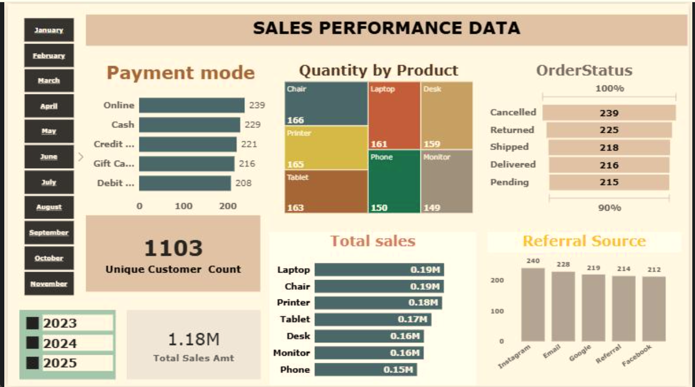

# 📊 Sales Performance Dashboard (Power BI)

An interactive Power BI dashboard that analyzes sales performance across products, payment modes, order status, and referral sources for 2023-2025.

## 🎯 Objective

To give business teams a quick, clear view of what is selling, how customers pay, where orders end up, and which channels bring customers in, so they can make faster, data-driven decisions.

## 📌 Key Metrics

| Metric | Value |
|---|---|
| Total Sales Amount | 1.18M |
| Unique Customers | 1,103 |

## 🔍 Dashboard Sections

- **Payment Mode:** Number of orders by Online, Cash, Credit Card, Gift Card, and Debit Card
- **Quantity by Product:** Units sold for Chair, Laptop, Desk, Printer, Phone, Tablet, and Monitor (treemap)
- **Order Status:** Cancelled, Returned, Shipped, Delivered, and Pending orders
- **Total Sales by Product:** Revenue contribution of each product
- **Referral Source:** Customers acquired through Instagram, Email, Google, Referral, and Facebook
- **Interactive Slicers:** Filter by month and year (2023, 2024, 2025)

## 💡 Key Insights

- **Laptop and Chair** are the top revenue products at 0.19M each, followed by Printer at 0.18M.
- **Chair** sells the highest quantity (166 units), followed by Printer (165) and Laptop (161).
- **Online** is the most used payment mode (239 orders), but all payment modes are fairly evenly split (208-239).
- **Instagram** is the top referral source (240), with Email (228) close behind.
- **Cancelled** is the largest order status (239), which makes it a good area to investigate for reducing lost sales.

## 🛠️ Tools Used

- Power BI (data modeling, visuals, slicers)

## 📁 Files in this Repository

- `dashboard.png`: Dashboard screenshot
- `README.md`: Project documentation

## 🚀 How to Explore

The screenshot above shows the full dashboard. In the live Power BI report, the month and year slicers filter every chart on the page.

## 👩‍💻 Author

**Bharti Saini**
Customer Support Team Leader transitioning into Data Analytics
📍 Gurgaon, India
🔗 [LinkedIn](https://www.linkedin.com/in/bharti-saini-a318bb2b2)
